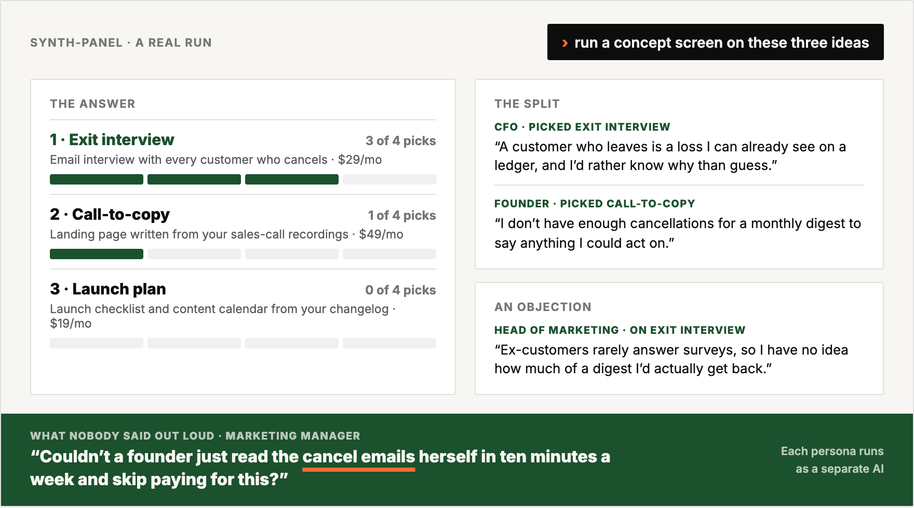
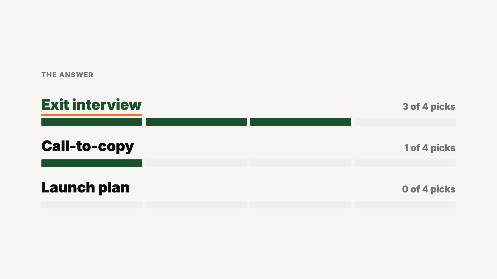
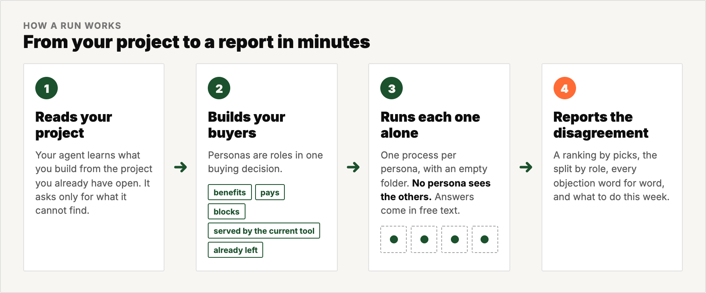

<h1 align="center">synth-panel</h1>

<p align="center">
  <strong>Test an idea, a price or a landing page on a panel of your own buyers before you ship it.</strong>
</p>

<p align="center">
  
  
  
  
</p>

<p align="center">
  
</p>

You build an app or a SaaS, and you have no audience to test every idea on. Ask one chatbot to play five buyers, and one model writes all five answers in one conversation. Those five cannot disagree.

synth-panel gives your AI agent a panel of your own buyers. Your agent builds them from your project, as roles in one buying decision. Each buyer runs as a separate AI, in its own empty folder, and cannot see the others. So the buyers can disagree, and the report shows you where.

> **AI agents:** read [`AGENTS.md`](AGENTS.md). It is the complete protocol.

---

## See a run

<!-- Video: drag assets/demo.mp4 into this README in the github.com editor. Replace the linked image below with the user-attachments URL that GitHub gives, so the video plays inline. -->
<p align="center">
  <a href="assets/demo.mp4"></a>
</p>

<p align="center"><sub>A real concept screen, from three product ideas to the objection that nobody said out loud.</sub></p>

## Before and after

| | One chatbot plays five buyers | synth-panel |
|---|---|---|
| Who answers | One model writes every buyer in one conversation | Each buyer runs as a separate AI, in its own empty folder |
| Who the buyers are | Generic personas | Roles in your buying decision: who benefits, pays, blocks or left |
| How they answer | A score on a scale, which crowds the middle | Free text in the buyer's own voice. Scores are an option |
| What you get | One average opinion | A ranking, the split by role, every objection word for word, a to-do |

## How it works

<p align="center">
  
</p>

Your agent saves the panel. The panel rotates between runs, so a revised draft meets fresh readers. The method, the research behind it and every file you can tune are in [`docs/method.md`](docs/method.md).

## What you can test

| You want to know | Tell your agent | You get |
|---|---|---|
| Which idea do I build? | `run a concept screen on these three ideas: …` | the ideas ranked, the strongest objection to each, and the idea that splits the panel |
| What do I build next? | `prioritise this backlog: …` | the features that buyers rank in opposite order, and the feature that nobody would miss |
| Does my offer and price work? | `test this offer and price: …` | the part that stops the deal: the outcome, the belief, the timeline, the effort or the price |
| Does my landing page work? | `run my landing page past the panel` | the exact line where each buyer stopped reading, and what each one thought you sell |
| Which name, tagline or plan? | `which of these would the panel pick: …` | a count of picks, and what each buyer thought it was for |
| How do my buyers talk? | `interview a buyer about how they handle <problem> today` | their own words, what they use today, and who else decides |
| What will stop my launch? | `pre-mortem this plan: …` | the causes of failure, ranked by how many personas named each one independently, and a to-do |
| How does it land in another market? | `run the same panel for buyers in Germany and in the US` | the same roles in each market, and where their answers differ |

A **panel** judges something that you show it. An **interview** takes nothing from you and returns the
buyer's vocabulary, which is the input your landing page needs. A **pre-mortem** takes a plan and tells
you how it failed.

<details>
<summary><strong>Read the full report from the run above</strong></summary>

This is a real run. Three product ideas went in front of four personas from the worked example in `examples/personas/`. The four are a bootstrapped founder, a head of marketing, a CFO and a marketing manager. Every quote is a persona's own words.

```
Panel: 4 personas · fidelity: hypothesis — grounded · rating: qualitative

THE ANSWER
1. Exit interview   3 of 4 picks   automatic email interview with every customer who cancels, $29/mo
2. Call-to-copy     1 of 4 picks   landing page written from your sales-call recordings, $49/mo
3. Launch plan      0 of 4 picks   launch checklist and content calendar from your changelog, $19/mo

THE SPLIT
Everyone inside a company that already has customers picked the exit interview.
The bootstrapped founder rejected it and picked call-to-copy.
  CFO:      "a customer who leaves is a loss I can already see on a ledger, and I'd rather
             know why than guess."
  Founder:  "I don't have enough cancellations for a monthly digest to say anything I could
             act on."

THE OBJECTIONS
  Exit interview · head of marketing: "Ex-customers rarely answer surveys, so I have no idea
    how much of a digest I'd actually get back."
  Call-to-copy · founder: "I don't have a stack of recorded sales calls, so there's nothing
    for it to pull phrases from yet."
  Launch plan · marketing manager: "The calendar comes from a changelog, which says what we
    built but not why a buyer would care, so I'd be rewriting every post anyway."

WHAT NOBODY SAID OUT LOUD
  Marketing manager: "Couldn't a founder just read the cancel emails herself in ten minutes
    a week and skip paying for this?"

DO THIS WEEK
1. Build the exit interview first, and sell it to companies that already have churn.
2. Put the response rate on the page. It is the first question from the person who has to
   defend the purchase.
3. Make the digest show what the cancellations cost. The CFO: "Curious only if it prices
   churn. Otherwise it's a newsletter."
```

</details>

## Built for, not built for

**Built for:** founders and teams who build an app or a SaaS, for consumer apps and for B2B buying committees. Test an idea, a backlog, a price, an offer, a page, a name or a launch plan before you ship it.

**Not built for:** a sales forecast, or a replacement for talks with real buyers. Every report states its level in the first line: `hypothesis — thin`, `hypothesis — grounded` or `evidence-anchored`. Real buyer sentences move a panel up that scale.

## Install with one message

Open the project that you are building. Tell your AI agent:

```
Clone https://github.com/4arkin/synth-panel and read its AGENTS.md.
Then build a buyer panel for this project and test my landing page on it.
```

Your agent clones the repo and learns what you build from your own project. Then it builds your buyer personas, runs each one in its own process, and gives you the report. Then continue: test the price, rank the backlog or interview a buyer.

## Works with

**Requirements:** Python 3 and an agent CLI. We tested the repo end to end on Claude Code. It ships
dispatch settings for Codex, Gemini CLI, Cursor Agent, opencode, Amp and Crush, and `doctor` confirms
yours in one command. Any other CLI that takes a prompt and prints an answer works with one line of
configuration.

You need no API key, no account and no marketing background. Manual commands are in [`docs/quickstart.md`](docs/quickstart.md).

## FAQ

**Is a synthetic panel not just invented answers?**
Researchers published the method and measured it against people. In a study by PyMC Labs and Colgate-Palmolive, synthetic respondents reached about 90% of human test-retest reliability. The study used 57 product surveys and 9,300 human responses ([arXiv:2510.08338](https://arxiv.org/abs/2510.08338)).

**Why not ask a chatbot to play five buyers?**
One model in one conversation writes all five, so they cannot disagree. Here each persona runs in its own process. It cannot see the other personas, your repo or the agent's reasoning. So their agreement is evidence.

**I have no customers yet. Where does the buyer language come from?**
Paste reviews of the product that your buyers use today, forum threads about the problem, or the replies to your cold emails. One real sentence per persona moves that persona to `evidence-anchored`.

**Can I get a score, not only words?**
Yes, as an option. Semantic Similarity Rating turns each written answer into a 1 to 5 distribution. You write a reference set and pass it through a gate first. A local embedding endpoint works and needs no key.

**Can I change the personas?**
Yes. They are plain files in `personas/`. Read them, correct them and keep them for the next run. `examples/personas/` holds a complete worked panel.

## Inside

| Path | What |
|---|---|
| [`AGENTS.md`](AGENTS.md) | The protocol that your agent follows |
| `personas/` | Your panel, as plain files |
| [`scenarios/`](scenarios/) | The questions for each kind of run |
| [`instruments/`](instruments/) | The procedure for panel, interview and pre-mortem |
| [`prompts/worker.md`](prompts/worker.md) | What each persona sees |
| [`config.toml`](config.toml) | The agent CLI, the panel size, the rotation between runs |
| [`examples/personas/`](examples/personas/) | A complete worked panel |
| [`docs/`](docs/) | Quickstart, method, persona generator, scoring |
| `bin/`, `synthpanel/`, `ssr/`, `tools/` | The engine |

## License

MIT. See [`LICENSE`](LICENSE).
